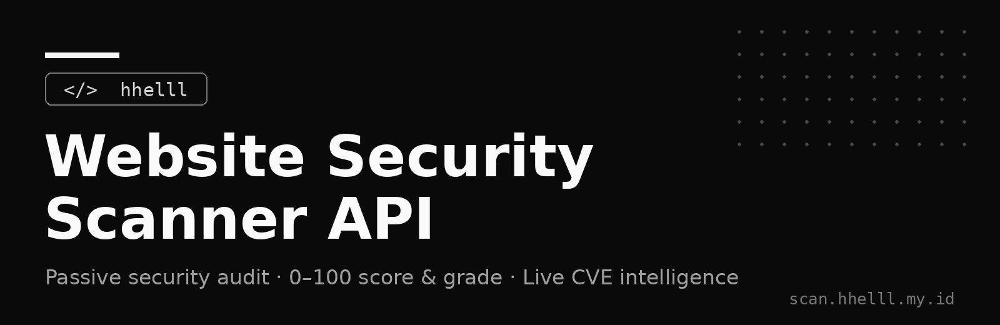
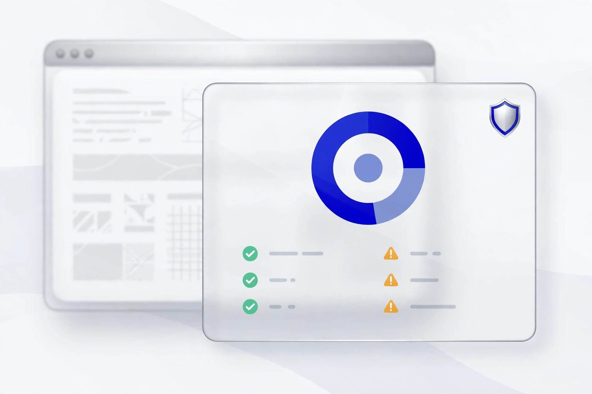

# Website Security Scanner API

   

Scan any public website's security posture in seconds — completely passively, with nothing installed on the target: HTTPS enforcement and TLS health, security headers, cookie flags, server information disclosure, exposed files such as `.env` and `.git`, mixed content, DNS and email authentication checks, Certificate Transparency subdomain surface, scan-to-scan change diffs, and outdated software matched against live CVE intelligence (EPSS exploit probability and CISA KEV active-exploitation data) — all rolled into one 0–100 score and a letter grade.

*This repository previously catalogued the dev-utility APIs family; it now documents a single flagship — the Website Security Scanner API.*

**Live on RapidAPI → [Website Security Scanner API](https://rapidapi.com/Hitler-HlDevZDwP/api/website-security-scanner-api)**

**Try it free, no signup → [scan.hhelll.my.id](https://scan.hhelll.my.id/)** — the official live scanner: score, grade, per-category pass/fail and findings, the same shape the free BASIC plan returns.



### What it does

Give the API a URL and it runs a full passive audit: it follows the redirect chain, inspects the TLS certificate and protocol support, checks six security headers and cookie flags, fingerprints the technology stack and matches detected versions against live CVE data, enriched with EPSS scores and CISA KEV status, probes a short list of commonly exposed files, and looks for mixed content. It also checks DNS and email authentication (SPF, DMARC, DKIM selectors, and CAA), looks for a published security.txt and HSTS preload status, maps the Certificate Transparency subdomain surface, and records each caller's scans so repeat scans can show what changed. Private and internal targets are refused (SSRF-protected) — it only scans public sites, and it never includes the contents of any exposed file, only that the path responded.

| | |
|---|---|
| Input | A `url` — as a query parameter (GET) or JSON body (POST) |
| Output | JSON — `score`, `grade`, summary counts by severity, and `findings` with per-check detail |
| Latency | ~2–10 seconds per scan (a real www.spacex.com scan through the gateway took 3.2 s) |
| Endpoints | `GET\|POST /scan`, `GET /headers`, `GET /ssl`, `GET /cve/search`, `GET /cve/{cve_id}`, `GET /scan/history`, `POST /scan/deep`, `POST /scan/deep/batch`, `GET /health` |

### Quick start

Subscribe on the API's [RapidAPI page](https://rapidapi.com/Hitler-HlDevZDwP/api/website-security-scanner-api) (there is a free plan), copy your `X-RapidAPI-Key` from the playground, then:

A runnable version of these calls lives in [`examples/secscan_example.sh`](examples/secscan_example.sh).

#### cURL

```bash
# Run a full security scan (GET with a query parameter)
curl "https://website-security-scanner-api.p.rapidapi.com/scan?url=https://example.com" \
  -H "X-RapidAPI-Key: YOUR_API_KEY" \
  -H "X-RapidAPI-Host: website-security-scanner-api.p.rapidapi.com"

# The same call as POST with a JSON body
curl -X POST "https://website-security-scanner-api.p.rapidapi.com/scan" \
  -H "X-RapidAPI-Key: YOUR_API_KEY" \
  -H "X-RapidAPI-Host: website-security-scanner-api.p.rapidapi.com" \
  -H "Content-Type: application/json" \
  -d "{\"url\": \"https://example.com\"}"
```

**Response:**

```json
{
  "url": "https://www.spacex.com",
  "score": 67,
  "grade": "C",
  "summary": { "critical": 0, "high": 1, "medium": 2, "low": 3, "info": 2 },
  "findings": [
    { "severity": "high", "title": "Sensitive file exposed: /server-status" },
    { "severity": "medium", "title": "Deprecated TLS protocols enabled" },
    { "severity": "medium", "title": "HTTP traffic is not redirected to HTTPS" },
    { "severity": "low", "title": "Missing X-Content-Type-Options header" },
    { "severity": "low", "title": "Missing Referrer-Policy header" },
    { "severity": "low", "title": "Missing Permissions-Policy header" },
    { "severity": "info", "title": "security.txt published" },
    { "severity": "info", "title": "DKIM record found" }
  ]
}
```

The scan endpoints accept **GET** (query parameters) or **POST** (JSON body with the same field names). Full details are in [`docs/website-security-scanner.md`](docs/website-security-scanner.md).

### API reference

#### `GET|POST /scan`

The full audit: score, grade, severity summary, every individual check, and the findings list.

| Parameter | Required | Notes |
|---|---|---|
| `url` | yes | The website to scan — a domain or a full URL, e.g. `https://example.com` |

#### `GET /headers`

Just the response-header part of the audit: the six security headers, cookie flags, and version disclosure (`Server` / `X-Powered-By`).

| Parameter | Required | Notes |
|---|---|---|
| `url` | yes | The website to check |

#### `GET /ssl`

Just the TLS part: certificate issuer and subject, validity window, days remaining, negotiated protocol and cipher, and whether legacy TLS 1.0/1.1 are still accepted. On PRO, `/ssl` (and `/scan`) responses also carry a `tls_deep` block — SSL Labs-style protocol, key-exchange and cipher-strength sub-scores with certificate-chain, OCSP-stapling and forward-secrecy detail, computed in the background per host and cached for 7 days (see the [full docs](docs/website-security-scanner.md)).

| Parameter | Required | Notes |
|---|---|---|
| `url` | yes | The website to check |

#### `GET /cve/search`

Looks up known vulnerabilities for a product and an optional exact version, matched live against NVD and OSV data and enriched with EPSS scores and CISA KEV exploitation status. Supported products include WordPress, Apache HTTP Server, nginx, PHP, jQuery, Log4j, OpenSSL, Bootstrap, IIS and LiteSpeed. Results are labelled `exact_version` (confirmed for that version) or `product_only` (potential, version not confirmed) and carry a 0–100 composite risk score.

| Parameter | Required | Notes |
|---|---|---|
| `product` | yes | Product name or alias, e.g. `wordpress`, `apache`, `log4j` |
| `version` | no | Exact version for confirmed matching |

#### `GET /cve/{cve_id}`

Returns one CVE record: summary, CVSS score and vector, EPSS score and percentile, the CISA KEV entry when actively exploited, references, and the composite risk score.


#### `GET /scan/history`

Returns the calling user's previous scans for one host, newest first (max 20). Every `/scan` response also includes a `changes` object with the score delta, new and resolved findings, and certificate expiry days versus that caller's previous scan of the same host. History is keyed per user via the RapidAPI caller headers.

| Parameter | Required | Notes |
|---|---|---|
| `host` | yes | The host to look up, e.g. `example.com` |

#### `GET /health`

Returns `{"status": "ok"}` when the service is up.

#### `POST /scan/deep`

Starts an asynchronous **deep scan** — a Nuclei-powered active template scan of one host — and returns `202` with a `job_id` to poll for the result. **Plans:** PRO (consumes deep scan credits).

#### `GET /scan/deep/{job_id}`

Returns the status and, once finished, the full result of a deep scan job. Only the API key that started the job can read it, and polling never consumes credits. **Plans:** the job owner's plan.

#### `POST /scan/deep/batch`

Queues deep scans for multiple hosts in one request. **Plans:** PRO — each host consumes one deep scan credit from the same pool as single deep scans (25/month, max 5/day); if the remaining quota covers only part of the batch, the rest are returned in `rejected[]` with a per-host reason. BASIC requests return `403`.

### Pricing

| Plan | Price | Included requests | Overage |
|---|---|---|---|
| BASIC | Free | 2 / month (hard limit) | — |
| PRO | $5 / month | 1,000 / month | $0.01 / request |

#### What each plan gets

| | BASIC — Free | PRO — $5/mo |
|---|---|---|
| Report detail | **Summary only** — score, grade, pass/fail per category, finding counts | **Full report** — every finding with evidence & fix recommendations |
| Deep TLS sub-scores (`tls_deep` on /scan & /ssl) | — | Yes — protocol / key-exchange / cipher scores, chain, OCSP & forward-secrecy detail |
| CVE intelligence lookups (/cve/search, /cve/{cve_id}) | Full records | Full records |
| Deep scan credits / month (Nuclei-powered active template scan) | — | 25 (max 5/day) |
| Scan result history & change diffs | Yes | Yes |

**Deep scan rules:** 1 credit = 1 host scanned. A scan that has been executed consumes its credit even if the target turns out to be unreachable or blocks the scanner — the work was performed. Invalid URLs and private/internal targets are rejected *before* execution and never consume a credit. Checking a job's status or fetching its result never consumes credits.

Subscribe and manage your plan here: **[Website Security Scanner API on RapidAPI](https://rapidapi.com/Hitler-HlDevZDwP/api/website-security-scanner-api)**

## License

The example code in this repository is released under the [MIT License](LICENSE). The API itself is a hosted service provided via RapidAPI under its plan terms.
