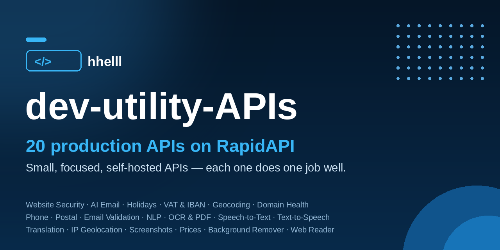

# dev-utility-APIs
  

**20 production APIs on RapidAPI** by **hhelll** — website security scanning, AI email writing, public holidays & business days, VAT & IBAN validation, geocoding, domain health checks, phone validation, postal codes, email validation, NLP utilities, OCR & PDF tools, speech-to-text, text-to-speech, translation, IP geolocation, website screenshots & PDF, currency/crypto prices, background removal, web page reading for AI agents, and weather forecasts. Small, focused, self-hosted APIs — each one does one job well, with a free plan to try it out.

**19 APIs are live now.** The Weather API is built and running, and its listing is **launching soon**.

## The API catalog

| API | What it does | Free plan | Paid plans (PRO / ULTRA / MEGA) |
|---|---|---|---|
| [Website Security Scanner API](https://rapidapi.com/Hitler-HlDevZDwP/api/website-security-scanner-api) — [docs](docs/website-security-scanner.md) | Passive website security audit: HTTPS & TLS health, security headers, cookie flags, exposed files (.env, .git), outdated software with known CVEs, mixed content — with a 0–100 score and grade | 2 requests/month | $12 / $29 / $59 |
| [AI Email Writer API](https://rapidapi.com/Hitler-HlDevZDwP/api/ai-email-writer-api) — [docs](docs/ai-email-writer.md) | AI email generation: write new emails, draft replies, and subject-line ideas — with tone control, in English and Indonesian | 5 requests/month | $10 / $25 / $49 |
| [Holidays and Business Days API](https://rapidapi.com/Hitler-HlDevZDwP/api/holidays-and-business-days-api) — [docs](docs/holidays.md) | Public holidays for 200+ countries, is-holiday / is-workday checks, and business-day counting | 5 requests/month | $9 / $19 / $39 |
| [VAT and IBAN Validation API](https://rapidapi.com/Hitler-HlDevZDwP/api/vat-and-iban-validation-api1) — [docs](docs/vat-iban.md) | EU VAT validation via the official VIES service, EU VAT rates, and IBAN validation with bank/BIC lookup | 5 requests/month | $12 / $29 / $59 |
| [Geocoding API](https://rapidapi.com/Hitler-HlDevZDwP/api/geocoding-api5) — [docs](docs/geocoding.md) | Forward and reverse geocoding over 236k places worldwide (GeoNames), plus nearest postal codes | 5 requests/month | $10 / $25 / $49 |
| [Domain Health API](https://rapidapi.com/Hitler-HlDevZDwP/api/domain-health-api) — [docs](docs/domain-health.md) | Domain health checks: DNS, SSL, RDAP/whois, email security (SPF/DMARC/MTA-STS), and an A–F health score | 5 requests/month | $10 / $25 / $49 |
| [Phone Number Validation API](https://rapidapi.com/Hitler-HlDevZDwP/api/phone-number-validation-api3) — [docs](docs/phone-validation.md) | Parse and validate international phone numbers: carrier, line type, country, and timezones | 5 requests/month | $9 / $19 / $49 |
| [Worldwide Postal Code API](https://rapidapi.com/Hitler-HlDevZDwP/api/worldwide-postal-code-api) — [docs](docs/postal-code.md) | 1.8M postal codes in 122 countries (GeoNames): lookup, place search, radius search, and distance between codes | 5 requests/month | $9 / $19 / $39 |
| [Email Validation API](https://rapidapi.com/Hitler-HlDevZDwP/api/email-validation-api44) — [docs](docs/email-validation.md) | Validate email addresses: syntax, MX records, disposable & role-based detection, typo suggestions, and a 0–100 deliverability score | 5 requests/month | $9 / $19 / $39 |
| [Text NLP Utilities API](https://rapidapi.com/Hitler-HlDevZDwP/api/text-nlp-utilities-api) — [docs](docs/text-nlp-utilities-api.md) | Summarize, sentiment analysis, keyword extraction, and language detection | 5 requests/month | $12 / $35 / $99 |
| [OCR and PDF Tools API](https://rapidapi.com/Hitler-HlDevZDwP/api/ocr-and-pdf-tools-api) — [docs](docs/ocr-and-pdf-tools-api.md) | OCR for English & Indonesian, PDF text extraction, merge, and compress | 5 requests/month | $12 / $35 / $99 |
| [Speech to Text API - Whisper Transcription](https://rapidapi.com/Hitler-HlDevZDwP/api/speech-to-text-api-whisper-transcription) — [docs](docs/speech-to-text-api-whisper-transcription.md) | Async audio transcription with subtitles (SRT/VTT), powered by Whisper | 5 requests/month | $10 / $29 / $75 |
| [Text to Speech API - Natural Voices](https://rapidapi.com/Hitler-HlDevZDwP/api/text-to-speech-api-natural-voices) — [docs](docs/text-to-speech-api-natural-voices.md) | Text to speech with natural English (US/GB) and Indonesian voices | 5 requests/month | $10 / $29 / $75 |
| [Translation API - EN ID ES FR DE JA](https://rapidapi.com/Hitler-HlDevZDwP/api/translation-api-en-id-es-fr-de-ja) — [docs](docs/translation-api-en-id-es-fr-de-ja.md) | Translation between EN, ID, ES, FR, DE, JA plus language detection | 5 requests/month | $10 / $29 / $75 |
| [IP Geolocation API](https://rapidapi.com/Hitler-HlDevZDwP/api/ip-geolocation-api25) — [docs](docs/ip-geolocation-api.md) | IP address → country, city, timezone, and ASN — single or batch lookups | 5 requests/month | $10 / $29 / $79 |
| [Website Screenshot and PDF API](https://rapidapi.com/Hitler-HlDevZDwP/api/website-screenshot-and-pdf-api) — [docs](docs/website-screenshot-and-pdf-api.md) | Website screenshots, URL → PDF, and Open Graph images | 5 requests/month | $9 / $29 / $79 |
| [Currency and Crypto Prices API](https://rapidapi.com/Hitler-HlDevZDwP/api/currency-and-crypto-prices-api) — [docs](docs/currency-and-crypto-prices-api.md) | Cached fiat exchange rates and crypto spot prices | 5 requests/month | $9 / $25 / $69 |
| [Background Remover AI](https://rapidapi.com/Hitler-HlDevZDwP/api/background-remover-ai5) | Remove image backgrounds → transparent PNG (plus replace-background, blur-background, and image conversion endpoints) | 5 requests/month | $5 / $15 / $49 |
| [Web Reader API](https://rapidapi.com/Hitler-HlDevZDwP/api/web-reader-api4) — [docs](docs/web-reader-api.md) | Turn any web page into clean, LLM-ready markdown or plain text, with title, author, date and word count — built for AI agents and RAG pipelines | 100 requests/month | $1 single PRO plan (10,000 requests, then $0.001 each) |
| Weather API - Global Forecast — [docs](docs/weather-api-global-forecast.md) | Current weather, 7-day forecast, and geocoding | *launching soon* | — |

## Get started (any API)

1. Open the API's RapidAPI page from the table above and subscribe to a plan (every API has a free plan).
2. Copy your `X-RapidAPI-Key` from the API playground.
3. Call the API from any language — each API's docs page in [`docs/`](docs/) has endpoints and a cURL example, and the [`examples/`](examples/) folder has runnable code for several of them.

---

## Featured API: Website Security Scanner API

Scan any public website's security posture in seconds — completely passively, with nothing installed on the target: HTTPS enforcement and TLS health, security headers, cookie flags, server information disclosure, exposed files such as `.env` and `.git`, mixed content, and outdated software with known vulnerabilities — all rolled into one 0–100 score and a letter grade.

**Live on RapidAPI → [Website Security Scanner API](https://rapidapi.com/Hitler-HlDevZDwP/api/website-security-scanner-api)**


### What it does

Give the API a URL and it runs a full passive audit: it follows the redirect chain, inspects the TLS certificate and protocol support, checks six security headers and cookie flags, fingerprints the technology stack and flags versions with curated known CVEs, probes a short list of commonly exposed files, and looks for mixed content. Private and internal targets are refused (SSRF-protected) — it only scans public sites, and it never includes the contents of any exposed file, only that the path responded.

| | |
|---|---|
| Input | A `url` — as a query parameter (GET) or JSON body (POST) |
| Output | JSON — `score`, `grade`, summary counts by severity, and `findings` with per-check detail |
| Latency | ~2–10 seconds per scan (a real google.com scan through the gateway took 2.6 s) |
| Endpoints | `GET\|POST /scan`, `GET /headers`, `GET /ssl`, `GET /health` |

### Quick start

Subscribe on the API's [RapidAPI page](https://rapidapi.com/Hitler-HlDevZDwP/api/website-security-scanner-api) (there is a free plan), copy your `X-RapidAPI-Key` from the playground, then:

#### cURL

```bash
# Run a full security scan (GET with a query parameter)
curl "https://website-security-scanner-api.p.rapidapi.com/scan?url=https://example.com" \
  -H "X-RapidAPI-Key: YOUR_API_KEY" \
  -H "X-RapidAPI-Host: website-security-scanner-api.p.rapidapi.com"

# The same call as POST with a JSON body
curl -X POST "https://website-security-scanner-api.p.rapidapi.com/scan" \
  -H "X-RapidAPI-Key: YOUR_API_KEY" \
  -H "X-RapidAPI-Host: website-security-scanner-api.p.rapidapi.com" \
  -H "Content-Type: application/json" \
  -d "{\"url\": \"https://example.com\"}"
```

**Response:**

```json
{
  "url": "https://google.com",
  "score": 76,
  "grade": "B",
  "summary": { "critical": 0, "high": 0, "medium": 2, "low": 3, "info": 0 },
  "findings": [
    { "severity": "medium", "title": "Deprecated TLS protocols enabled" },
    { "severity": "medium", "title": "Missing Content-Security-Policy header" },
    { "severity": "low", "title": "Missing X-Content-Type-Options header" },
    { "severity": "low", "title": "Missing Referrer-Policy header" },
    { "severity": "low", "title": "Cookies set without the HttpOnly flag" }
  ]
}
```

The scan endpoints accept **GET** (query parameters) or **POST** (JSON body with the same field names). Full details are in [`docs/website-security-scanner.md`](docs/website-security-scanner.md).

### API reference

#### `GET|POST /scan`

The full audit: score, grade, severity summary, every individual check, and the findings list.

| Parameter | Required | Notes |
|---|---|---|
| `url` | yes | The website to scan — a domain or a full URL, e.g. `https://example.com` |

#### `GET /headers`

Just the response-header part of the audit: the six security headers, cookie flags, and version disclosure (`Server` / `X-Powered-By`).

| Parameter | Required | Notes |
|---|---|---|
| `url` | yes | The website to check |

#### `GET /ssl`

Just the TLS part: certificate issuer and subject, validity window, days remaining, negotiated protocol and cipher, and whether legacy TLS 1.0/1.1 are still accepted.

| Parameter | Required | Notes |
|---|---|---|
| `url` | yes | The website to check |

#### `GET /health`

Returns `{"status": "ok"}` when the service is up.

#### `POST /scan/deep`

Starts an asynchronous **deep scan** — a Nuclei-powered active template scan of one host — and returns `202` with a `job_id` to poll for the result. **Plans:** PRO, ULTRA and MEGA (consumes deep scan credits).

#### `GET /scan/deep/{job_id}`

Returns the status and, once finished, the full result of a deep scan job. Only the API key that started the job can read it, and polling never consumes credits. **Plans:** the job owner's plan.

#### `POST /scan/deep/batch`

Starts deep scans for up to 20 URLs in one call, one credit per host. **Plans:** MEGA only.

### Pricing

| Plan | Price | Included requests | Overage |
|---|---|---|---|
| BASIC | Free | 2 / month (hard limit) | — |
| PRO | $12 / month | 1,000 / month | $0.01 / request |
| ULTRA | $29 / month | 5,000 / month | $0.006 / request |
| MEGA | $59 / month | 20,000 / month | $0.003 / request |

#### What each plan gets

| | BASIC — Free | PRO — $12/mo | ULTRA — $29/mo | MEGA — $59/mo |
|---|---|---|---|---|
| Report detail | **Summary only** — score, grade, pass/fail per category, finding counts | **Full report** — every finding with evidence & fix recommendations | Full report | Full report |
| Advanced checks (SPF/DMARC, security.txt, HSTS preload, TLS cipher details, extended tech fingerprinting) | — | — | ✓ | ✓ |
| Deep scan credits / month (Nuclei-powered active template scan) | — | 25 (max 5/day) | 100 (max 15/day) | 300 (max 30/day) |
| Passive subdomain enumeration (deep scan) | — | — | ✓ | ✓ |
| Light port check (deep scan) | — | — | — | ✓ |
| Batch deep scan submit | — | — | — | ✓ |
| Queue priority | — | Standard | Priority | Highest |
| Scan result history | — | 7 days | 30 days | 90 days |

**Deep scan rules:** 1 credit = 1 host scanned. A scan that has been executed consumes its credit even if the target turns out to be unreachable or blocks the scanner — the work was performed. Invalid URLs and private/internal targets are rejected *before* execution and never consume a credit. Checking a job's status or fetching its result never consumes credits.

Subscribe and manage your plan here: **[Website Security Scanner API on RapidAPI](https://rapidapi.com/Hitler-HlDevZDwP/api/website-security-scanner-api)**

## License

The example code in this repository is released under the [MIT License](LICENSE). The APIs themselves are hosted services provided via RapidAPI under their plan terms.
